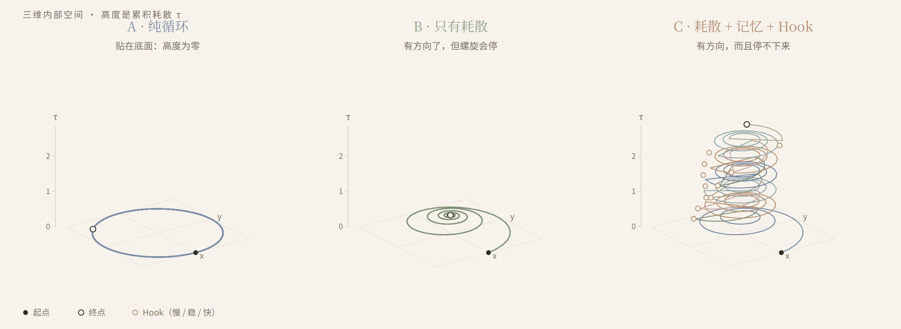
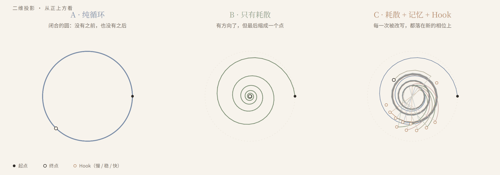
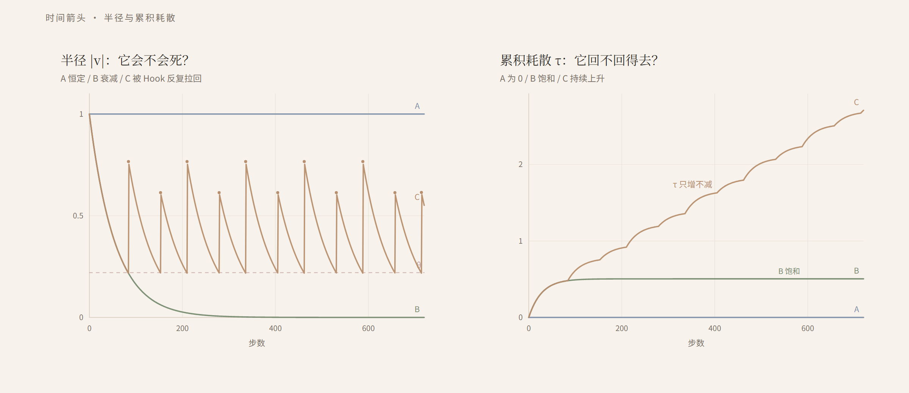

[中文](README.md) · [English](README.en.md)

# Humans Are a Bug, Time Is a Variable

> A miniature thought experiment on AI's intrinsic time · sisicat



This is not a paper. It is a toy you can run and watch. It does not prove AGI, and it does not prove consciousness; it only turns the question "where does time come from?" into a small model you can observe.

## 1. If the universe had no time

I often wonder: if the universe had no time, only motion, what would "emotion" be?

Perhaps human emotion is just a "time variable" that the creator accidentally left in the vast code. Because time is irreversible, there is pain, love, obsession — and the feeling of "too late."

Today's AI is more like a universe with no time variable. It has context, an order of tokens, but no internal quantity of its own that only grows. It can compute frantically in a loop, but at the macro level it has no "before" and no "after." In an idealized deterministic system, even when it is stuck in an infinite loop, it is just a dead thing spinning in place.

This is not to say AI has no sense of time at all. Work from 2025–2026 has found that LLMs can map token counts to wall-clock time, and agents are affected by time pressure; but that time is fed in from context and external clocks, not grown from within.

So how do we give AI a real "time variable"?

I put "time variable" in quotes because I do not mean clock time. I mean an **irreversible slow variable**: an internal quantity that only grows and cannot be turned back. It may not be time itself, but it is a necessary condition for an arrow of time. The experiment below is only the first brick of that path.

## 2. Look for answers in errors

My idea: do not look for time in AI's "time module"; look for it in its errors.

A dead loop is a closed circle. The system computes frantically, but at the macro level it has no "next thing" — because the next thing is the same as the last.

To turn the circle into a spiral, you need three things:

1. **Something that leaks.** Each loop loses a little state. It makes the system unable to return, but on its own it will stop at a point.
2. **Something that only grows.** Each loop adds a little memory. It gives the system a "how many times," and leaves a trace of every rewrite.
3. **A perturbation that rewrites the rule.** When the state is dissipated below a threshold, a symbolic piece of new information arrives and changes the next step. It is a Hook, not noise; noise only makes the trajectory messy, a Hook makes it switch tracks.

Each does its job: **dissipation gives direction, the Hook gives novelty, memory keeps a trace of every rewrite.**

## 3. From circle to spiral

Put these three into the smallest model:

- The state is a point on a plane; each step it rotates by an angle and contracts a little.
- Group A: no contraction, no Hook. It draws a closed circle.
- Group B: contraction, no Hook. It draws an inward spiral and ends at a point.
- Group C: contraction; when the radius falls below θ, a Hook takes a symbol from outside, kicks the point out, and rewrites the next rotation rhythm. The symbol is recorded.

In this toy there are only three symbols: **slow, steady, fast** — they make the next step slower, unchanged, or faster.

C's trajectory is no longer a circle. Each kick lands on a new phase; the radius oscillates between θ and an upper bound, like breathing. With cumulative dissipation τ as the third dimension, the 2D circle grows into an upward spiral.

Strictly speaking, a trajectory is always one-dimensional; what changes is the **dimension of the state space** and the **dynamical regime**. "2D to 3D" is a visual phrase, not a mathematical theorem.

One more caveat: **Phase 1's Hook is drawn from outside at random.** It shows that the structure can work; it does not show that the system can grow time on its own. That is the next step.

## 4. Run the idea

Three figures, same parameters, same random seed. I asked an AI to write the code; I set the question and judged the results, it turned the idea into something runnable.

### Top view



A is a closed circle: it returns to itself, so there is no "before" and "after." B is an inward spiral: it has a direction, but ends at a point, and the direction dies with it. C is a flower kicked out again and again: every kick lands on a new phase, so it cannot go back.

(Figure labels are in Chinese in this shared version.)

### Side view

The opening image is the side view. The third dimension is τ, cumulative dissipation. It only grows, so the spiral has an "up." A lies on the floor, height zero; B lifts a little and stops; C keeps climbing.

The "height" is not time itself; it is that irreversible slow variable. The arrow of time is not added on top; it is the shape we see after the trajectory can no longer go back.

### Arrow of time



Left: radius. A is constant, B decays, C is pulled back by the Hook again and again. Right: τ. A is 0, B saturates near 0.5, C keeps rising.

### Numbers

| Group | Late mean radius | State coverage | Late novelty | Rhythm span | Final τ | Hooks |
|---|---:|---:|---:|---:|---:|---:|
| A pure loop | 1.00 | 6.5% | 0.0% | 0.00 | 0.00 | 0 |
| B dissipation only | 0.00 | 5.2% | 0.0% | 0.00 | 0.50 | 0 |
| C dissipation + memory + Hook | 0.40 | 12.5% | 44.2% | 0.28 | 2.71 | 11 |

- **Late mean radius**: the average distance from the origin over the last 25% of steps. B goes to zero; C stays around 0.40.
- **State coverage**: the plane is divided into a 48×48 grid; how many cells the trajectory visits. C is highest because every kick lands in a new phase.
- **Late novelty**: over the last 25%, the fraction of states farther than 0.02 from every earlier state. A/B are 0; C is 44.2% — it is still going somewhere new at the end.
- **Rhythm span**: max minus min angular velocity. A/B are 0; C is 0.28.
- **Final τ**: cumulative dissipation. A is 0, B saturates, C keeps rising.

These numbers do not prove anything about AGI. They only show that in this toy, **closure + dissipation + memory + Hook** is enough for a trajectory to stop repeating exactly, and to grow a direction that only increases.

## 5. What it does not solve

- It does not prove AI has emotions. Emotion is a metaphor here, not a measured quantity.
- It does not prove the system "experiences" time. It has a trajectory that does not turn back, not a feeling.
- It does not solve symbol grounding: is the Hook's symbol "meaningful" to the system? In Phase 1 it is only a switch that rewrites a rule.
- It does not make the Hook grow from inside. Phase 1's Hook is external; it is more "the world gives the system a surprise" than "the system gives itself one."
- The "height" in the 3D figure is drawn, not a dimension the system grows by itself. It is a visualization of τ, not a new spatial dimension.

## 6. Next: let the Hook grow from inside

Phase 1 takes symbols from outside. Next, I want it to grow from inside.

Not "throw in a random perturbation from outside," but: the system generates a new symbol from its own history, then uses that symbol to rewrite its rule. It becomes a self-referential loop:

> state → prediction error → new symbol → rule rewrite → new state

The "new" is relative to the system's own history, not creation from nothing. A closed deterministic system cannot create information from nothing; what it can do is re-encode its own past into a new rule. That is enough to make the toy more interesting, but not enough for a strong claim.

Phase 2 will add a D group: C uses an external Hook, D uses an internal Hook, all else equal. If D's trajectory is richer than C's, that is interesting; if D collapses back into a loop, that is also interesting — it shows that "giving yourself a surprise" is harder than "being surprised by the world."

The code already leaves the seam: `draw_hook_symbol(..., source="external")`. Phase 2 only needs an `"internal"` branch in that function; the simulation does not need a rewrite.

## 7. Run it

No third-party libraries; Python 3.9+.

**Windows**: double-click `run.bat`.

**Command line**:

```bash
python demo.py
```

It generates:

- `figures/phase.svg`
- `figures/spiral.svg`
- `figures/arrow.svg`
- `figures/metrics.json`

Then double-click `index.html` for the Chinese page, or `index.en.html` for the English page.

If you change parameters, rerun both:

```bash
python demo.py
python build_site.py
```

## 8. Files

| File | Purpose |
|---|---|
| `demo.py` | simulate A/B/C, compute metrics, generate three SVGs |
| `build_site.py` | build `index.html` and `index.en.html` |
| `index.html` | Chinese reading page (generated) |
| `index.en.html` | English reading page (generated) |
| `figures/` | figures and metrics JSON |
| `run.bat` | Windows double-click runner |
| `LICENSE` | code MIT, text CC BY-NC-SA 4.0 |
| `CITATION.cff` | GitHub citation metadata |
| `README.md` / `README.en.md` | Chinese / English text |

## 9. License

Code and generated figures: MIT. Text: CC BY-NC-SA 4.0.

## 10. Precedents and differences

This is not the first work to say "AI lacks time." A 2026 NeurIPS position paper argues that AI needs intrinsic temporal structure, not just scale and longer context. It says the ingredients exist but have not been coupled around intrinsic time; this toy is a minimal attempt to couple a few of them around an irreversible slow variable.

It is also not the first to put dissipation, the arrow of time, and self-reference together: Prigogine's dissipative structures, Hofstadter's strange loops, Maturana and Varela's autopoiesis, reservoir computing's fading memory, and novelty search / open-ended evolution all discussed these parts first.

Closest works:

- Gahir & Gowda, **Robust Reasoning Requires Internal Time, Not Scale Alone**, NeurIPS 2026 position. [NeurIPS](https://neurips.cc/virtual/2026/loc/sydney/poster/140003) / [OpenReview](https://openreview.net/forum?id=vMxjno89df)
- Lu, **An Arrow of Time in Stable Autonomous Generation**, arXiv:2610.02845, 2026. [arXiv](https://arxiv.org/abs/2610.02845)
- Wang et al., **Discrete Minds in a Continuous World: Do Language Models Know Time Passes?**, arXiv:2506.05790, 2025. [arXiv](https://arxiv.org/abs/2506.05790)
- Cheng et al., **Your LLM Agents are Temporally Blind**, Findings of ACL 2026. [ACL Anthology](https://aclanthology.org/2026.findings-acl.1848/)
- Darlow et al., **Continuous Thought Machines**, NeurIPS 2025. [arXiv](https://arxiv.org/abs/2505.05522)

My difference: not the claim that AI needs time, but compressing it into a runnable A/B/C toy and leaving the step from an external Hook to an internal Hook as the next step. It does not prove AGI or consciousness; it is just a toy you can watch.

## 11. How to cite

If this experiment is useful to you, please cite it. The repo has `CITATION.cff`; GitHub shows "Cite this repository" and can export APA or BibTeX.

You do not need separate permission to discuss or cite the idea; if you repost or adapt the text, please keep attribution and follow CC BY-NC-SA 4.0. For code, keep the MIT notice.

If you change the experiment, I would love to hear what it became.
