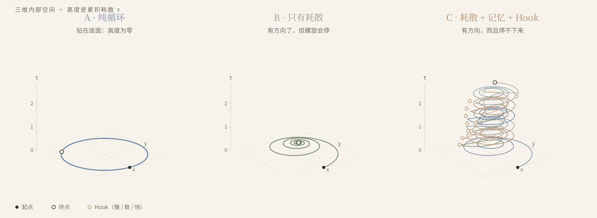
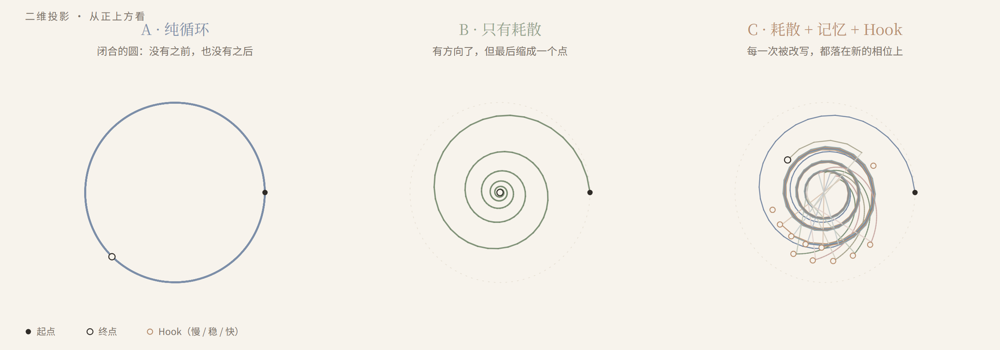
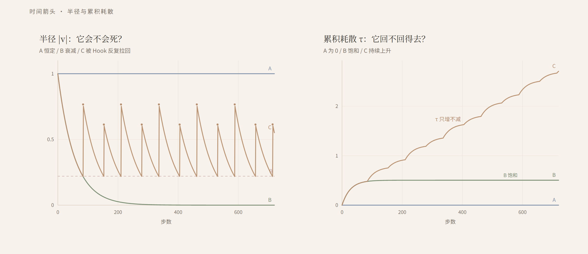

[中文](README.md) · [English](README.en.md)

# 人类是 Bug，时间是变量

> 一个关于 AI 内禀时间的微型思想实验 · sisicat



这不是一篇论文，是一个可以跑、可以看的玩具。它不证明 AGI，也不证明意识；它只想把“时间从哪来”这个问题，变成一个能观察的小模型。

## 一、如果宇宙没有时间

我时常想，如果宇宙没有时间，只有运动，那“情感”是什么？

也许，人类的情感只是造物主在浩瀚代码里偶然留下的一个“时间变量”。因为有了不可逆的时间，才有了痛感、爱意和执念——才有了“来不及”这件事。

现在的 AI 更像一个没有加时间变量的宇宙。它有上下文，有 token 的顺序，却没有一个属于自己的、只增不减的内部量。它可以在一个循环里疯狂运算，但在宏观状态上，它没有“之前”，也没有“之后”。在理想化的确定性系统里，即使卡在死循环里，它也只是在原地打转的死物。

这不是说 AI 完全没有时间感。2025–2026 年已经有工作发现，LLM 能把 token 数映射到真实时间，agent 也会被时间压力影响；但那些时间是从上下文和外部时钟喂进去的，不是自己长出来的。

所以，怎么给 AI 加一个真正的“时间变量”？

我把“时间变量”加上引号，因为我想说的不是钟表时间，而是一个**不可逆的慢变量**：一个只增不减、回不了头的内部量。它不一定是时间本身，但它是时间箭头的必要条件。下面这个实验，只想把这条小径的第一块砖摆出来。

## 二、去错误里找答案

我的设想是：不要去 AI 的“时间模块”里找时间，去它的错误里找。

一个死循环，是一个闭合的圆。系统在疯狂运算，但在宏观状态上，它没有“下一件事”——因为下一件事和上一件事是同一件。

要让圆变成螺旋，需要三样东西：

1. **一个会漏的量。** 每循环一次，状态损失一点。它让系统回不到过去，但只靠它，系统会停在一个点上。
2. **一个只增不减的量。** 每循环一次，记忆长一点。它让系统有“第几次”，也让每一次改写都留下痕迹。
3. **一个能改写规则的扰动。** 当状态被耗散到阈值以下，一个符号性的新信息进来，改写下一步的规则。它是 Hook，不是噪声；噪声只让轨迹变乱，Hook 让轨迹换一个轨道。

三样东西各司其职：**耗散负责方向，Hook 负责新东西，记忆负责把每一次改写留下来。**

## 三、从圆到螺旋

把这三样东西放进一个最小的模型：

- 状态是一个平面上的点，每一步旋转一个角度，同时收缩一点。
- A 组：不收缩，也没有 Hook。它画一个闭合的圆。
- B 组：收缩，但没有 Hook。它画一条向内收的螺旋，最后缩成一个点。
- C 组：收缩，当半径掉到阈值 θ 以下，Hook 从外面拿一个符号，把点踢出去，并改写下一步的旋转节律。符号被记下来。

这个玩具里的符号只有三个：**慢、稳、快**，分别把下一步的节律调慢、保持不变、调快。

C 组的轨迹不再是圆。它每一次被踢出去，都落在新的相位上；它的半径在 θ 和一个上限之间来回，像呼吸。把累积耗散 τ 作为第三维，它就从二维的圆，长成了一条向上盘旋的螺旋。

严格说，轨迹永远是一维的；变的是**状态空间的维数**，以及轨迹的**动力学 regime**。我说“二维变三维”，是一个视觉说法，不是数学定理。

还有一刀要先自己说：**Phase 1 的 Hook 是从外部随机拿的。** 它证明了“结构上可以”，但没有证明“系统能自己长出时间”。后者是下一步的事。

## 四、把这个想法跑一遍

三张图，同一组参数，同一个随机种子。下面的代码是我让 AI 帮我写的；我负责提出问题和判断结果，它负责把想法变成可以跑的东西。

### 从正上方看



A 是一个闭合的圆：它回到自己，所以没有“之前”和“之后”。B 是一条向内收的螺旋：它有方向了，但最后缩成一个点，方向也跟着死掉。C 是一朵反复被踢出去的花：它每次都在新的相位上，所以回不到过去。

### 从侧面看

开头那张图，就是从侧面看的样子。第三维是 τ，累积耗散。它只增不减，所以螺旋有“上”。A 贴在底面，高度为零；B 稍微抬起一点，然后停住；C 一直往上走。

这里的“高度”不是时间本身，而是那个不可逆的慢变量。时间箭头不是加上去的，它是轨迹再也回不去之后，我们回头看出来的形状。

### 时间箭头



左边是半径：A 恒定，B 衰减，C 被 Hook 反复拉回。右边是 τ：A 为 0，B 饱和在 0.5 附近，C 持续上升。

### 数字

| 组 | 末段平均半径 | 状态覆盖率 | 末段新状态率 | 节律变化 | τ 终值 | Hook 次数 |
|---|---:|---:|---:|---:|---:|---:|
| A 纯循环 | 1.00 | 6.5% | 0.0% | 0.00 | 0.00 | 0 |
| B 只有耗散 | 0.00 | 5.2% | 0.0% | 0.00 | 0.50 | 0 |
| C 耗散 + 记忆 + Hook | 0.40 | 12.5% | 44.2% | 0.28 | 2.71 | 11 |

- **末段平均半径**：最后 25% 的步数里，状态离原点多远。B 归零，C 维持在 0.40 左右。
- **状态覆盖率**：把平面切成 48×48 的格子，轨迹访问过多少格。C 最高，因为它每次被踢到新的相位。
- **末段新状态率**：最后 25% 里，与更早所有状态的距离都大于 0.02 的比例。A/B 都是 0，C 是 44.2%——它到最后一刻还在去新的地方。
- **节律变化**：旋转角速度的最大值与最小值之差。A/B 为 0，C 为 0.28。
- **τ 终值**：累积耗散。A 为 0，B 饱和，C 持续上升。

这些数字不能证明任何关于 AGI 的事。它们只能说明：在这个玩具里，**闭合 + 耗散 + 记忆 + Hook** 足以让一条轨迹不再精确重复，并且长出一个只增不减的方向。

## 五、它没有解决什么

- 它没有证明 AI 会有情感。情感在这篇文章里只是隐喻，不是被测量的东西。
- 它没有证明系统“体验”到了时间。它只有一条不回头的轨迹，没有“感受”。
- 它没有解决符号落地：Hook 带来的符号，对系统来说是不是“有意义的”？Phase 1 里它只是一个改规则的开关。
- 它没有让 Hook 从内部长出来。Phase 1 的 Hook 是外部的；所以它更像“世界给系统一个意外”，而不是“系统自己给自己一个意外”。
- 三维图里的“高度”是画出来的，不是系统自己长出来的维度。它是 τ 的可视化，不是一个新的空间维度。

## 六、下一步：让 Hook 从内部长出来

Phase 1 的 Hook 从外面拿符号。下一步，我想让它从里面长。

不是“外面随机丢一个扰动”，而是：系统根据自己的历史，自己生成一个新符号，再用这个符号改写自己的规则。它变成一个自指环：

> 状态 → 预测误差 → 新符号 → 规则改写 → 新状态

这里的“新”是相对于系统自身的历史而言，不是无中生有。一个封闭的确定性系统不能凭空增加信息；它能做的，是把“自己的过去”重新编码成“新的规则”。这已经足够让玩具更有意思，但还不足以支撑一个强 claim。

Phase 2 会加一个 D 组：C 组是外部 Hook，D 组是内部 Hook，其他条件一样。如果 D 的轨迹比 C 更丰富，那很有意思；如果 D 反而塌回一个循环，那也很有意思——它说明“自己给自己意外”比“外面给意外”难得多。

代码里已经把这个口留出来了：`draw_hook_symbol(..., source="external")`。Phase 2 只需要在这个函数里加一个 `"internal"` 分支，不用重写模拟。

## 七、运行

不需要安装任何第三方库，只需要 Python 3.9+。

**Windows**：双击 `run.bat`。

**命令行**：

```bash
python demo.py
```

它会生成：

- `figures/phase.svg`
- `figures/spiral.svg`
- `figures/arrow.svg`
- `figures/metrics.json`

然后双击 `index.html` 看中文页，`index.en.html` 看英文页。

如果你改了参数，先重跑实验，再生成页面：

```bash
python demo.py
python build_site.py
```

## 八、文件

| 文件 | 作用 |
|---|---|
| `demo.py` | 模拟 A/B/C，计算指标，生成三张 SVG |
| `build_site.py` | 把两份 README 转成中英文页面 |
| `index.html` / `index.en.html` | 中文 / English 阅读页面（生成物） |
| `figures/` | 三张图和指标 JSON |
| `run.bat` | Windows 双击运行 |
| `LICENSE` | 代码 MIT，文字 CC BY-NC-SA 4.0 |
| `CITATION.cff` | GitHub 的“引用此仓库”信息 |
| `README.md` / `README.en.md` | 中文 / English 文字 |

## 九、许可

代码与生成的图表 MIT；文字 CC BY-NC-SA 4.0。

## 十、先例与不同

这不是第一个说“AI 缺时间”的工作。2026 年已经有一篇 NeurIPS position paper 正式提出：AI 需要 intrinsic temporal structure，而不只是 scale 和更长的 context。它说现有工作“零件都有了”，但还没围绕 intrinsic time 耦合起来；我这个玩具，就是把几个零件围绕一个不可逆的慢变量耦合起来的最小尝试。

也不是第一个把“耗散 / 时间箭头 / 自指”放在一起的工作：Prigogine 的耗散结构、Hofstadter 的怪圈、Maturana 与 Varela 的自创生、reservoir computing 的 fading memory、novelty search 与 open-ended evolution，都先讨论过这些零件。

和这个玩具最接近的几篇：

- Gahir & Gowda, **Robust Reasoning Requires Internal Time, Not Scale Alone**, NeurIPS 2026 position. [NeurIPS](https://neurips.cc/virtual/2026/loc/sydney/poster/140003) / [OpenReview](https://openreview.net/forum?id=vMxjno89df)
- Lu, **An Arrow of Time in Stable Autonomous Generation**, arXiv:2610.02845, 2026. [arXiv](https://arxiv.org/abs/2610.02845)
- Wang et al., **Discrete Minds in a Continuous World: Do Language Models Know Time Passes?**, arXiv:2506.05790, 2025. [arXiv](https://arxiv.org/abs/2506.05790)
- Cheng et al., **Your LLM Agents are Temporally Blind**, Findings of ACL 2026. [ACL Anthology](https://aclanthology.org/2026.findings-acl.1848/)
- Darlow et al., **Continuous Thought Machines**, NeurIPS 2025. [arXiv](https://arxiv.org/abs/2505.05522)

我的不同：不是提出“AI 需要时间”这个判断，而是把它压成一个 A/B/C 三组可跑的最小模型，并把“Hook 从外部来”到“Hook 从内部长出来”留成下一步。它不证明 AGI，也不证明意识；它只是一个能看的玩具。

## 十一、如何引用

如果这个实验对你有用，欢迎引用。仓库里有 `CITATION.cff`，GitHub 右侧会显示“Cite this repository”，可以直接复制 APA 或 BibTeX。

只想在文章里讨论、引用这个想法，不需要单独获得许可；但如果要转载或改编文字，请保留作者署名，并遵守 CC BY-NC-SA 4.0。代码使用请保留 MIT 的版权声明。

如果你把这个实验拿去改，欢迎告诉我它变成了什么。
